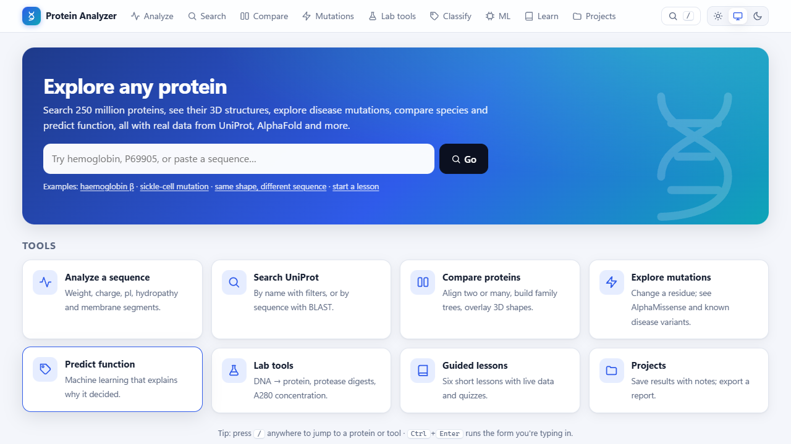

# Protein Analyzer

A local web app and Python package for learning about and analysing proteins with real data from **UniProt**,
**AlphaFold DB**, **InterPro** and **EBI**. You can analyse sequences, search all of UniProt, view 3D structures,
explore mutations, compare many proteins and draw family trees, predict function with machine learning (and see
*why* the model predicted it), follow guided lessons, and keep everything in projects. It's aimed at students and
learners: every technical term has an ⓘ explanation.



Watch the 2-minute tour: [showcase/protein_analyzer_showcase.mp4](showcase/protein_analyzer_showcase.mp4)

## Run it

**Easiest (Windows, no Python needed):** download `ProteinAnalyzer-1.5.0-windows.zip` from the
[latest release](https://github.com/saiph67/protein-analyzer/releases/latest), unzip it, and double-click
`ProteinAnalyzer.exe`. Your browser opens the app. Windows may warn about an unrecognised app the first time;
choose **More info → Run anyway**. The .exe leaves out PyTorch to stay small, so it uses the hand-crafted model;
the ESM-2 model needs the Python version. To build the .exe yourself, run `build_exe.bat`.

**From Python** (3.10+, built and tested on 3.14, Windows 11):

```bash
git clone https://github.com/saiph67/protein-analyzer.git
cd protein-analyzer
pip install -r requirements.txt
python app.py
```

Or double-click **`run.bat`**. The app opens http://127.0.0.1:5000 and only listens on `127.0.0.1`.

**Optional ESM-2 model** (much more accurate; about 250 MB CPU-only install plus a 140 MB model download on first use):

```bash
pip install torch --index-url https://download.pytorch.org/whl/cpu
pip install -r requirements-esm.txt
```

**For a class (shared server):** see [DEPLOY.md](DEPLOY.md). It covers public mode (`serve.py`, a production server)
and a `Dockerfile`.

| Env var | Default | Meaning |
|---|---|---|
| `PA_PORT` | `5000` | port |
| `PA_RESULTS_DIR` | `./results` | dataset, models, reports, figures |
| `PA_DATA_DIR` | `./userdata` | your projects |
| `PA_CACHE_DIR` | `./.cache/uniprot` | cache of UniProt / AlphaFold / InterPro responses (7-day TTL) |
| `PA_OPEN_BROWSER` | `1` | `0` = don't open a browser tab on start |
| `PA_ESM_MODEL` | `facebook/esm2_t12_35M_UR50D` | ESM-2 checkpoint (`facebook/esm2_t6_8M_UR50D` is about 3× faster) |
| `PA_PUBLIC`, `PA_HOST`, `PA_RATE_PER_MIN` | off | shared-server mode (DEPLOY.md) |

## Pages

| Page | What it does |
|---|---|
| **Analyze** | Paste or upload sequences/FASTA. Shows MW, GRAVY, pI, charge, aromaticity and composition, plus an interactive hydropathy plot (hover for values, click a TM region to highlight it). Export to CSV, JSON or PDF; save to a project. |
| **Search → by name** | Filters for organism, *reviewed only* and length. Shows the exact UniProt query. Tick two results to compare them. |
| **Search → by sequence (BLAST)** | Search **all of UniProt** (Swiss-Prot, UniRef50, human, or everything) for similar sequences using EBI's BLAST service. Results show identity, E-value and the aligned region. Tick hits to build a family tree; download CSV. *EBI requires an email per search: you type it, it stays in your browser, and it's sent only to EBI.* |
| **Protein detail** | Function, GO, EC, keywords. **Interaction partners from STRING** as a draggable network, with evidence types for each partner. **Reactome pathways**, split into normal biology and disease. A **secondary-structure & disorder track** read from the 3D model. A 3D AlphaFold structure coloured by confidence, helix/strand or rainbow. **UniProt annotations next to the app's own TM prediction**. **Pfam domains from InterPro.** Click any annotation or domain to highlight it in the sequence and in 3D. Buttons: compare, mutations, BLAST, classify, FASTA, save, print. |
| **Compare → two proteins** | Global/local alignment with identity, similarity, gaps, coverage, a plain-English verdict, a colour-coded alignment and a download. |
| **Compare → 3D structures** | Overlay the AlphaFold models of two proteins (pairs matched by sequence alignment, least-squares fit on the confident core). Reports **TM-score** and **RMSD**, a plain-English verdict ("same fold", "different shapes"), a per-residue distance plot, and helix/strand/disorder content for both. Haemoglobin α vs myoglobin: only 25% identical in sequence, yet TM-score 0.91 and core RMSD 1.3 Å. |
| **Lab tools** | **DNA → protein:** six-frame translation and ORF finder (standard, vertebrate-mitochondrial and bacterial codes, optional alternative start codons), GC content, and one-click hand-off of an ORF to Analyze, Classify, BLAST or Digest. **Protease digest:** trypsin, Lys-C, Arg-C, Glu-C, Asp-N, chymotrypsin, pepsin and CNBr, with missed cleavages, length/mass filters, monoisotopic masses, [M+H]⁺/[M+2H]²⁺/[M+3H]³⁺, a coverage bar and CSV export. **A280:** extinction coefficient (Pace/ProtParam), Abs 0.1%, and concentration from your absorbance reading. |
| **Compare → many + family tree** | 3–20 proteins (accessions or FASTA): **multiple alignment** (center-star, coloured by chemistry, conservation marks), an **identity heatmap**, and a **neighbour-joining family tree**. Download FASTA and Newick. Runs entirely on your computer. |
| **Mutations** | Change any residue and see what happens: chemistry change, BLOSUM62, local hydropathy, whole-protein changes, and plain-English notes. For human proteins there's an **AlphaMissense heatmap of all ~19 × length substitutions** (click a cell to apply it). **Known variants from UniProt** are listed, e.g. sickle cell E7V and HbC E7K. |
| **Classify** | Predict function (7 classes) from sequences, FASTA files or accessions with either model. Batch table, CSV, save. **"Why this prediction?"** shows which sequence regions the model relied on (both models) and which properties pushed it (hand-crafted model), in plain words. |
| **Dataset & ML** | Build datasets, train either model as a cancellable background job, and compare both models' honest results. |
| **Learn** | Six guided lessons using live data, with quizzes, saved progress and printable worksheets: membrane proteins, charge and pI, evolution and homology, sickle-cell anaemia, reading AlphaFold structures, and how honest an ML score is. |
| **Projects** | Save proteins, analyses, comparisons, alignments, mutations, BLAST results and classifications with notes. Export one **report** (print/PDF), Markdown or JSON; **back up all** projects to one file and **import** them again. |

Everywhere: ⓘ tooltips, a light/dark/auto theme, a phone-friendly layout, and print-friendly pages.

## Everyday use

- **Home page** with one search box: type a protein name, an accession (P69905) or paste a sequence, and it goes to the right tool.
- **Jump anywhere:** press <kbd>/</kbd> or <kbd>Ctrl</kbd>+<kbd>K</kbd> on any page to open a protein, a tool or a recent protein.
- **<kbd>Ctrl</kbd>+<kbd>Enter</kbd>** runs the form you're typing in.
- **Dark mode:** the switch at the top right offers Light, System and Dark. Your choice is remembered.
- **Your work is kept:**
  - What you type into any form is saved automatically and restored when you come back (with a *Clear* link).
  - **Projects** store results with notes. **Back up all** downloads every project as one file, and **Import…** restores it, on this or another computer.
- **Copy buttons** on sequences and alignments; a **More ▾** menu and a sticky **section bar** on protein pages; **back-to-top** button.
- Works on phones: the menu folds into a ☰ button.

## The models and their real accuracy

**Data.** 7 classes from UniProt keywords: kinase (KW-0418), protease (KW-0645), ion channel (KW-0407), ribosomal
protein (KW-0689), toxin (KW-0800), DNA-binding (KW-0238), plus **other** (none of these). The data is reviewed,
non-fragment, 50–2000 aa entries. Proteins with more than one class keyword and exact duplicates are excluded.
Each class is sampled **in proportion across 8 taxonomic groups**. My first dataset took UniProt's top results,
which were mostly human for some classes and none for others, so a model could cheat by recognising the organism.

**Test.** A time split: 2,735 training proteins first published up to 2018-12-31, and 663 hold-out proteins
published after. Built from live UniProt on 2026-10-24. Chance is 14%.

| | hold-out accuracy | balanced acc. | **< 30% identity to training** (n=482) | **redundancy-filtered** (n=524) |
|---|---|---|---|---|
| **ESM-2 language model + logistic regression** | **79.9%** | **80.2%** | **73.7%** | **75.8%** |
| Hand-crafted features + random forest | 56.9% | 58.0% | 50.6% | 52.3% |
| 1-NN homology transfer (copy the closest protein's label) | 49.2% | 49.3% | | 35.9% |
| Amino-acid composition only (logistic regression) | 45.9% | 46.8% | | |
| Majority class / random guess | 15.1% / 13.9% | | | |

- **Identity** is the highest local-alignment identity between a hold-out protein and its 5 most k-mer-similar
  training proteins.
- **Redundancy-filtered** removes the 139 hold-out proteins that are ≥ 40% identical to any of them. This
  approximates 40%-identity clustering (as MMseqs2/CD-HIT would do) at the train/test boundary. Homology transfer
  collapses there (35.9%); ESM-2 barely moves, so it isn't just recognising relatives.
- Per-class recall (ESM-2): toxin 93%, kinase 91%, ribosomal 91%, ion channel 84%, protease 80%, DNA-binding 79%,
  **other 44%**. "Other" is a mixed bag, so it's the hardest class.
- **ESM-2 caveat:** its unlabelled pre-training data (about 2021) includes some post-2018 hold-out sequences. It
  never saw their labels, but the scores may be slightly optimistic for proteins discovered after 2021.

Full details: `results/report_esm2.md`, `results/report_handcrafted.md`.

## Research readiness: accuracy you can report

| Check | Result |
|---|---|
| **pI & molecular weight vs ExPASy** (live Compute pI/Mw tool, 46 proteins) | pI within 0.01 (rounding) on all 46; MW identical. The app uses ExPASy's Bjellqvist pK values. Note that ExPASy applies the N-terminal but not the C-terminal residue correction, so Biopython differs for acidic C-termini. |
| **Secondary structure vs DSSP** (171 AlphaFold models, 48,650 confident residues; `benchmarks/ss_benchmark.md`) | The app now runs DSSP itself (a port of PyDSSP, identical output on 62,176 residues; prolines excluded as donors as in the original DSSP): **99.6%** agreement. The previous C-alpha method scored 77.8%, so it is now only a fallback. PyDSSP's authors report >97% agreement with the original DSSP. |
| **Provenance** | Every CSV/JSON/text download, saved project item, project report and printout records the app version, date, UniProtKB release (read from UniProt's response headers), the methods used and the data sources with licences. |
| **Methods & citations page** (`/methods`, linked in every page footer) | How to report results, citations and licences for every data source, and per-method accuracy with the standard tool to cross-check against. |

Re-run the benchmarks with `python benchmarks/ss_benchmark.py`; the pI regression tests use ExPASy reference values.

## Command line

```bash
python -m protein_analyzer fetch P69905 P01308 --analyze
python -m protein_analyzer analyze my.fasta --plot plots/
python -m protein_analyzer compare P69905 P68871 --mode global
python -m protein_analyzer dataset --per-class 400 --holdout 100     # live UniProt, 3-5 min (--no-other to skip "other")
python -m protein_analyzer train --backend handcrafted               # ~4 min (redundancy check aligns ~3,300 pairs)
python -m protein_analyzer train --backend esm2                      # ~15 min first run (embeddings cached)
python -m protein_analyzer predict P00533 my.fasta                   # uses the best trained model
```

## Package layout

```
app.py                     Flask app (JSON API + pages)      serve.py    production server (public mode)
build_exe.bat              -> dist\ProteinAnalyzer\ProteinAnalyzer.exe       Dockerfile, DEPLOY.md
protein_analyzer/
  analyzer.py              sequence properties, hydropathy, TM prediction
  compare.py               pairwise alignment (Gotoh, numpy rows), k-mer similarity
  msa.py                   center-star multiple alignment, neighbour-joining tree, Newick
  mutations.py             single-residue substitutions, AlphaMissense matrix
  structure.py             structure features, disorder, Kabsch superposition, TM-score
  dssp.py                  DSSP secondary structure (memory-efficient port of PyDSSP, MIT)
  provenance.py            versions, methods, sources, licences and citations stamped on exports
  labtools.py              DNA translation/ORFs, protease digests + peptide masses, A280
  uniprot.py               UniProt, AlphaFold DB, AlphaMissense, InterPro, STRING, Reactome (cache, throttle, retries)
  ebi.py                   EBI BLAST job client
  features.py              434 hand-crafted features        embeddings.py   optional ESM-2 embeddings
  ml.py                    dataset (taxon-stratified), training, redundancy check, prediction
  explain.py               region scan + random-forest feature contributions
  projects.py              project store + Markdown export   jobs.py   background jobs (cancel, restart-safe)
templates/, static/        plain HTML/CSS/JS, no build step; static/lessons.js; static/vendor/3Dmol-min.js (BSD)
tests/                     pytest suite (offline; external services mocked)
```

## Tests

```bash
pytest                      # 93 tests, fully offline
python tests/test_all.py    # package tests only
```

`tests/make_synthetic.py` makes **fake** data for smoke tests only. No accuracy from it is reported anywhere.

## What was tested live vs mocked

- **Live (2026-10-24), in a browser:** every page. That includes the mutation explorer (HBB E7V: AlphaMissense
  0.22, 4 known variants at position 7), the globin and insulin family trees (β/δ and γ/ε pair up, myoglobin is
  the outgroup), Pfam domains for EGFR (kinase domain 714–966), ESM-2 explanations, lessons with live demos, the
  save-to-project → report flow, phone width (375 px) in light mode, job cancel and restart, and public mode under
  waitress (training blocked, projects off, rate limit enforced). Also live: dataset builds and both models' training.
  Lab tools and structures: the HBB coding DNA translates to the exact 147-aa protein. BSA tryptic peptides
  (LVNELTEFAK 1163.63, YLYEIAR 927.49, HLVDEPQNLIK 1305.72) and angiotensin II [M+H]⁺ 1046.5418 match reference
  masses, and ubiquitin's ε280 matches ProtParam (1490). Secondary structure agrees with known folds: haemoglobin α
  has no strands and GFP is about half strand. For superposition,
  haemoglobin α vs myoglobin gives TM 0.91 and α vs GFP gives TM 0.11. The EGFR interaction network (16 partners)
  and its 37 Reactome pathways load correctly.
- **Mocked / offline:** the pytest suite (all external services are faked).
- **Not tested live:** an actual **BLAST search**. EBI requires a real email per search, and I didn't submit one on
  your behalf. Submitting, polling and result parsing are unit-tested against EBI's documented JSON format, and
  EBI's live rejection of a missing email was confirmed. Run one search yourself to finish verifying it.
- **Not tested:** the **Dockerfile** (Docker isn't installed here), and how pages look when printed on paper.

## Known limitations

- Only 69 ion-channel entries were published after 2018 (68 hold-out instead of 100).
- AlphaMissense covers human proteins only. It also misses "gain-of-function" mutations like sickle cell
  (which the lesson uses as a teaching point).
- The redundancy check aligns each hold-out protein to its 5 closest training proteins by a k-mer prefilter, so
  a rare distant homolog could be missed. True all-vs-all clustering needs MMseqs2/CD-HIT.
- The center-star alignment is simple. For large or very distant families, Clustal Omega or MAFFT align better.
- Kyte–Doolittle TM prediction is crude; the protein page shows UniProt's real annotations next to it.
- Pairwise alignment is capped at 3,000 × 3,000 residues; multiple alignment at 20 × 1,500.
- Secondary structure is assigned from *predicted* AlphaFold models, not experimental structures.
- Structure overlay pairs residues by *sequence* alignment, so it works best for proteins that align. Truly
  sequence-free structural alignment (TM-align, DALI) can match unrelated sequences better.
- STRING links mean "associated" (shared pathway, co-expression, literature…), not necessarily physical contact.
  Reactome mainly covers human and model organisms.
- 3D structures, AlphaMissense, Pfam and BLAST need internet (results are cached afterwards).
