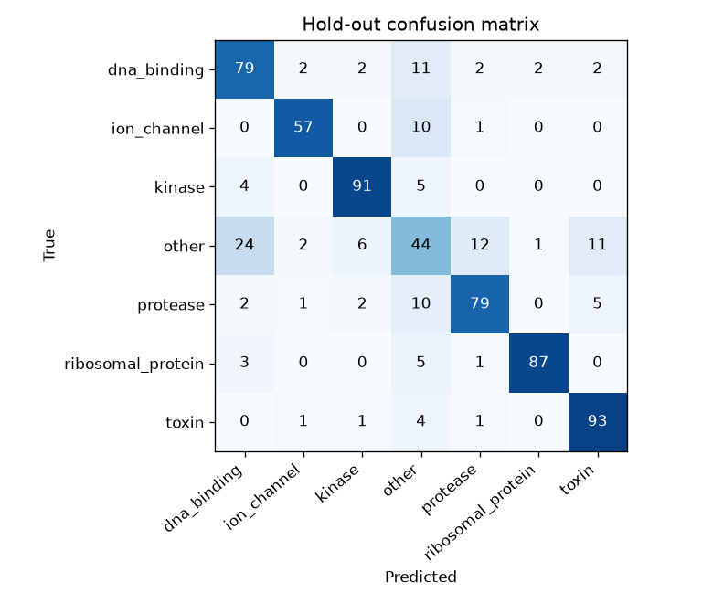
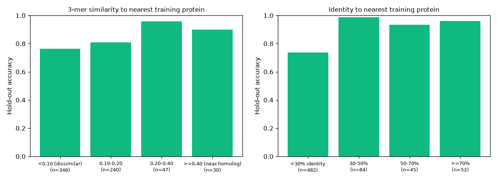
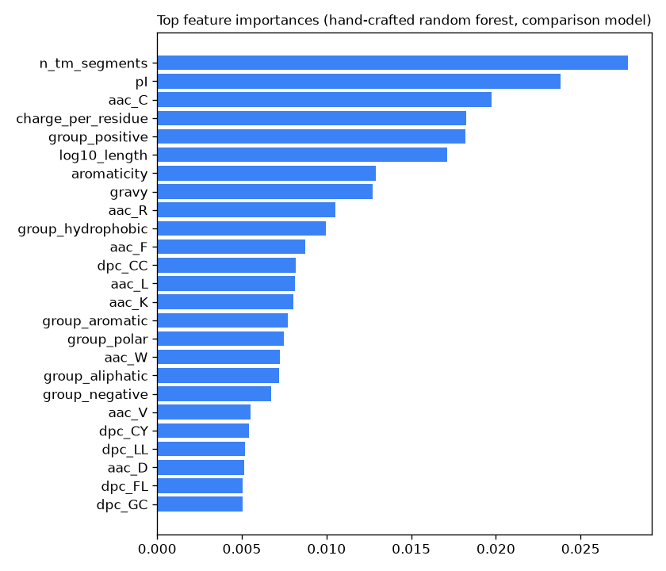
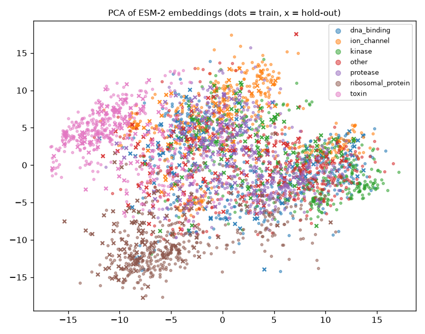

# Protein function classifier - evaluation report

Generated 2026-10-24T21:31:18. All data downloaded from the **live UniProtKB REST API**.

## Setup

- Model: LogisticRegression(C=0.1) on 480-d ESM-2 embeddings (480 input features). Features: mean-pooled ESM-2 protein language-model embeddings (pre-trained on UniRef; the language model never saw our labels). Caveat: its unlabelled pre-training data (~2021) includes some sequences from our post-cutoff hold-out, so results may be slightly optimistic.
- Time split: train = reviewed entries first published <= **2018-12-31**; hold-out = published after.
- Filter: `reviewed:true AND fragment:false AND length:[50 TO 2000]`; entries with >1 of the class keywords excluded.
- Classes: kinase (KW-0418), protease (KW-0645), ion_channel (KW-0407), ribosomal_protein (KW-0689), toxin (KW-0800), dna_binding (KW-0238), other (none of the other keywords)
- Note: ion_channel: only 69 holdout entries available (wanted 100).
- Note: Removed 71 duplicate accessions/sequences.

| class             |   train |   hold-out | hold-out recall   |
|-------------------|---------|------------|-------------------|
| dna_binding       |     399 |        100 | 79.0%             |
| ion_channel       |     388 |         68 | 83.8%             |
| kinase            |     377 |        100 | 91.0%             |
| other             |     400 |        100 | 44.0%             |
| protease          |     396 |         99 | 79.8%             |
| ribosomal_protein |     376 |         96 | 90.6%             |
| toxin             |     399 |        100 | 93.0%             |

## Hold-out results (time split)

| method                                                                  | accuracy   | balanced acc.   | macro-F1   |
|-------------------------------------------------------------------------|------------|-----------------|------------|
| **Logistic regression on ESM-2 language-model embeddings (this model)** | 79.9%      | 80.2%           | 80.1%      |
| random forest, hand-crafted features                                    | 56.4%      | 57.6%           | 55.2%      |
| majority class                                                          | 15.1%      | 14.3%           | 3.7%       |
| random (stratified)                                                     | 13.9%      | 14.2%           | 13.9%      |
| logistic regression, composition only (20 AAC)                          | 45.9%      | 46.8%           | 45.7%      |
| 1-NN k-mer homology transfer                                            | 49.2%      | 49.3%           | 49.0%      |

## Leakage check: accuracy vs. similarity to the training set

For each hold-out protein we find its 5 most similar training proteins (3-mer Jaccard), align it to each (local alignment; identical residues / shorter length) and keep the highest identity. A newer entry that is a close homolog of an older one is easy; the low-similarity rows are the honest measure of generalisation to genuinely new proteins.

| 3-mer similarity      |   n | accuracy   |
|-----------------------|-----|------------|
| <0.10 (dissimilar)    | 346 | 76.3%      |
| 0.10-0.20             | 240 | 80.8%      |
| 0.20-0.40             |  47 | 95.7%      |
| >=0.40 (near-homolog) |  30 | 90.0%      |

| identity to nearest train protein   |   n | accuracy   |
|-------------------------------------|-----|------------|
| <30% identity                       | 482 | 73.7%      |
| 30-50%                              |  84 | 98.8%      |
| 50-70%                              |  45 | 93.3%      |
| >=70%                               |  52 | 96.2%      |

- Median nearest-neighbour similarity: 0.097; median identity: 10.7%
- **Low-similarity hold-out (3-mer < 0.10, n=346): accuracy 76.3%, balanced 75.6%**
- **Hold-out with < 30% identity to any training protein (n=482): accuracy 73.7%, balanced 76.4%**

### Redundancy-filtered hold-out

Removing the 139 hold-out proteins that are >= 40% identical to any of their 5 closest training proteins leaves n=524:

| method                 | accuracy   | balanced acc.   | macro-F1   |
|------------------------|------------|-----------------|------------|
| this model             | 75.8%      | 78.0%           | 77.6%      |
| 1-NN homology transfer | 35.9%      |                 |            |

This approximates clustering at 40% identity (as MMseqs2/CD-HIT would) for the train/hold-out boundary. Candidates come from a 3-mer prefilter, so a rare distant homolog could be missed.

## Confusion matrix (rows = true, columns = predicted)

| true \ pred       |   dna_binding |   ion_channel |   kinase |   other |   protease |   ribosomal_protein |   toxin |
|-------------------|---------------|---------------|----------|---------|------------|---------------------|---------|
| dna_binding       |            79 |             2 |        2 |      11 |          2 |                   2 |       2 |
| ion_channel       |             0 |            57 |        0 |      10 |          1 |                   0 |       0 |
| kinase            |             4 |             0 |       91 |       5 |          0 |                   0 |       0 |
| other             |            24 |             2 |        6 |      44 |         12 |                   1 |      11 |
| protease          |             2 |             1 |        2 |      10 |         79 |                   0 |       5 |
| ribosomal_protein |             3 |             0 |        0 |       5 |          1 |                  87 |       0 |
| toxin             |             0 |             1 |        1 |       4 |          1 |                   0 |      93 |

## Top features (hand-crafted random forest)

| feature            |   importance |
|--------------------|--------------|
| n_tm_segments      |      0.02781 |
| pI                 |      0.02384 |
| aac_C              |      0.01977 |
| charge_per_residue |      0.01825 |
| group_positive     |      0.01821 |
| log10_length       |      0.01712 |
| aromaticity        |      0.0129  |
| gravy              |      0.01274 |
| aac_R              |      0.01053 |
| group_hydrophobic  |      0.00994 |
| aac_F              |      0.00874 |
| dpc_CC             |      0.00818 |
| aac_L              |      0.00815 |
| aac_K              |      0.00806 |
| group_aromatic     |      0.00771 |

## Class patterns

| class             |   n |   median len |   GRAVY |    pI |   frac. TM | enriched residues               |
|-------------------|-----|--------------|---------|-------|------------|---------------------------------|
| dna_binding       | 499 |          389 |  -0.423 |  7.4  |      0.122 | Q (+0.9%), E (+0.9%), R (+0.7%) |
| ion_channel       | 456 |          444 |   0.144 |  7.52 |      0.967 | L (+2.4%), F (+1.9%), I (+1.2%) |
| kinase            | 477 |          476 |  -0.221 |  6.59 |      0.279 | L (+0.8%), E (+0.7%), D (+0.7%) |
| other             | 500 |          391 |  -0.214 |  6.65 |      0.312 | A (+0.6%), D (+0.5%), Q (+0.4%) |
| protease          | 495 |          506 |  -0.281 |  6.75 |      0.535 | S (+0.7%), N (+0.6%), D (+0.5%) |
| ribosomal_protein | 472 |          165 |  -0.491 | 10.57 |      0.028 | K (+3.5%), R (+3.1%), V (+2.0%) |
| toxin             | 499 |          113 |  -0.208 |  7.34 |      0.707 | C (+5.0%), K (+1.2%), Y (+1.1%) |

## Figures

